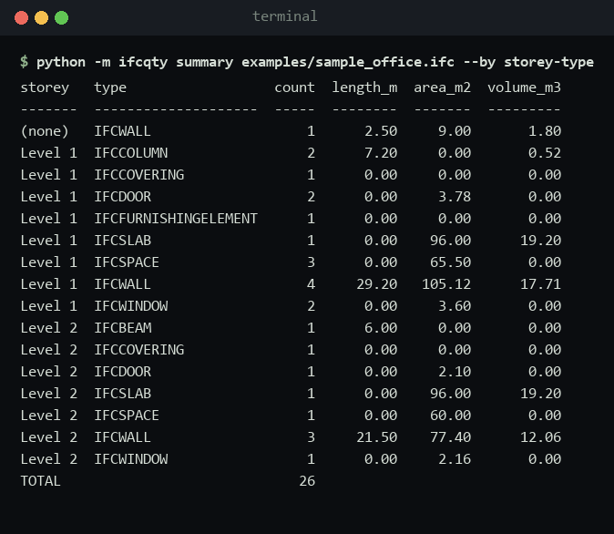

<p align="center"></p>

# ifc-quantity-extractor

[](https://github.com/yassine2med/ifc-quantity-extractor/actions/workflows/ci.yml)  

A quantity takeoff from a BIM model usually means opening a heavy viewer and exporting a spreadsheet. This repo reads the IFC STEP text directly with the Python standard library (no ifcopenshell), pulls the element quantities the modeler stored, and gives you totals by type, storey or material, plus a CSV with one row per element.



## What it is for

Estimators, facility managers and project engineers need wall lengths, floor areas, door counts and volumes from a model, quickly and in a form that goes into a spreadsheet. This tool gives grouped totals and a per-element CSV. It also shows what has no storey or no material, which is a quick check on model quality.

## Install

```
git clone https://github.com/yassine2med/ifc-quantity-extractor
cd ifc-quantity-extractor && pip install -r requirements.txt
```

No third-party packages are needed. Python 3.10 or newer.

## How to use

| I want to | Command |
|---|---|
| Totals by element type | `PYTHONPATH=src python -m ifcqty summary examples/sample_office.ifc` |
| Totals by storey | `PYTHONPATH=src python -m ifcqty summary examples/sample_office.ifc --by storey` |
| Totals by material | `PYTHONPATH=src python -m ifcqty summary examples/sample_office.ifc --by material` |
| One line per element, doors only | `PYTHONPATH=src python -m ifcqty elements examples/sample_office.ifc --type IFCDOOR` |
| Write every element to CSV | `PYTHONPATH=src python -m ifcqty csv examples/sample_office.ifc --out takeoff.csv` |
| File stored in metres, not millimetres | add `--unit m` |

Exit codes: 0 on success, 1 when no element matches, 2 when the file is missing, not IFC STEP, or the type is not supported.

Example:

```
PYTHONPATH=src python -m ifcqty summary examples/sample_office.ifc
```

Output:

```
type                  count  length_m  area_m2  volume_m3
--------------------  -----  --------  -------  ---------
IFCBEAM                   1      6.00     0.00       0.00
IFCCOLUMN                 2      7.20     0.00       0.52
IFCCOVERING               2      0.00     0.00       0.00
IFCDOOR                   3      0.00     5.88       0.00
IFCFURNISHINGELEMENT      1      0.00     0.00       0.00
IFCSLAB                   2      0.00   192.00      38.40
IFCSPACE                  4      0.00   125.50       0.00
IFCWALL                   8     53.20   191.52      31.57
IFCWINDOW                 3      0.00     5.76       0.00
TOTAL                    26
```

By storey:

```
storey   count  length_m  area_m2  volume_m3
-------  -----  --------  -------  ---------
(none)       1      2.50     9.00       1.80
Level 1     16     36.40   274.00      37.43
Level 2      9     27.50   237.66      31.26
TOTAL       26
```

Door list:

```
#98   IFCDOOR    Door D01                 Level 1  L    0.00  A    1.89  V   0.00
#107  IFCDOOR    Door D02                 Level 1  L    0.00  A    1.89  V   0.00
#115  IFCDOOR    Door D03                 Level 2  L    0.00  A    2.10  V   0.00
```

Run the tests with `python -m pytest -q`.

## How it works

1. `src/ifcqty/ifc.py` parses the DATA section of the STEP file into entities and indexes the relationships: property and quantity sets, spatial containment, aggregation and materials.
2. For each building element and space it reads `IfcElementQuantity` values. Length comes from `Length`, area from the first of `NetSideArea`, `NetArea`, `GrossArea`, `NetFloorArea`, `GrossFloorArea`, and volume from `NetVolume` or `GrossVolume`.
3. Doors and windows with no area quantity get an area from `Width` times `Height`.
4. Lengths are scaled to metres from the unit you give with `--unit` (the file's own unit assignment is not read).
5. Rows are grouped and printed. The TOTAL row sums only the count, because a wall side area and a floor area should not be added together.

`examples/sample_office.ifc` is a small hand written IFC4 model with 26 elements and spaces on two storeys.

## Limits

- Only quantities stored in the file are used. It does not compute them from geometry.
- Reads IFC STEP text (`.ifc`); no IFCXML or zipped files.
- Units are chosen by `--unit`; the IfcUnitAssignment in the file is ignored.
- Supported types: walls, doors, windows, slabs, columns, beams, coverings, furnishing and spaces.

## License

MIT. Yassine Emhamed, 2026.
